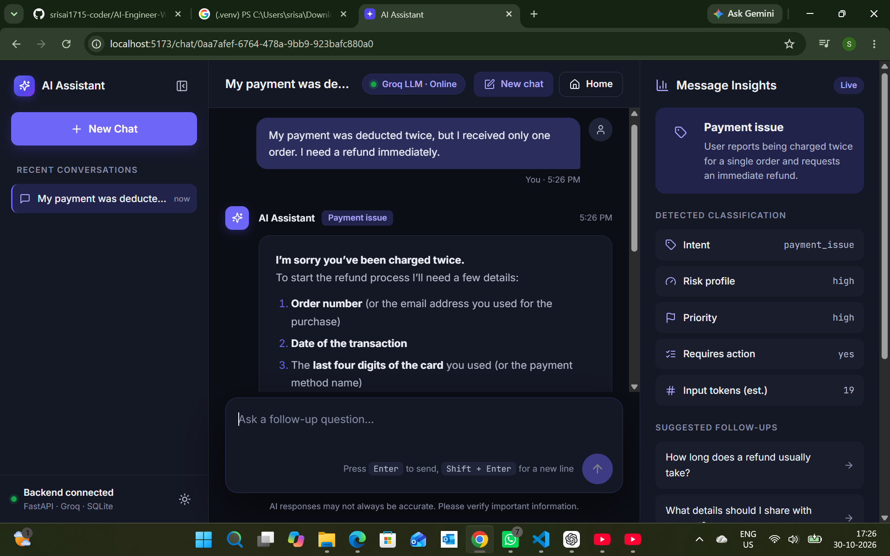
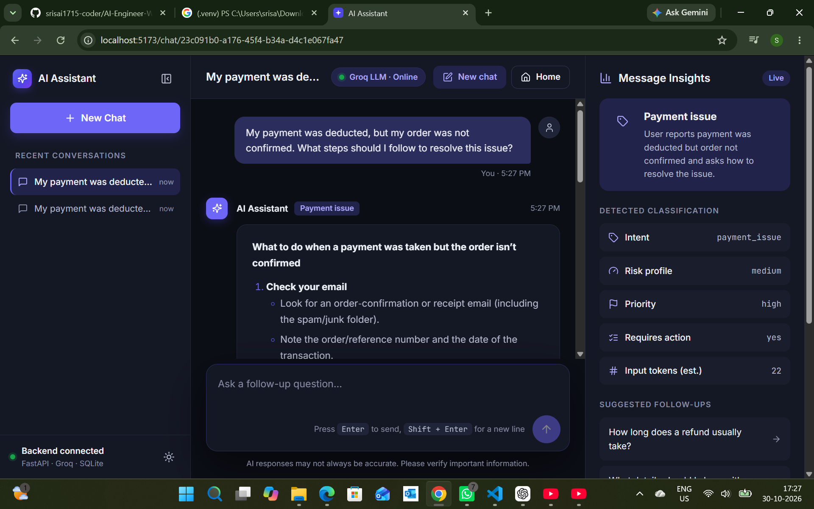
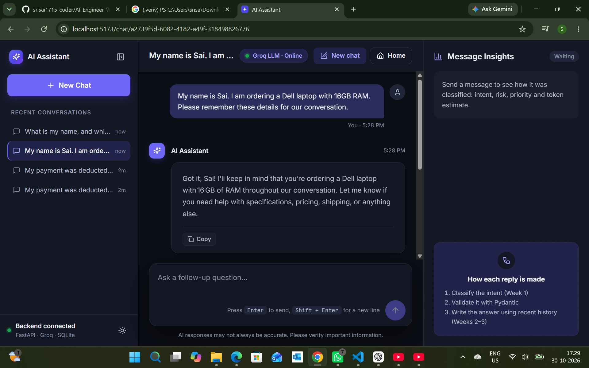
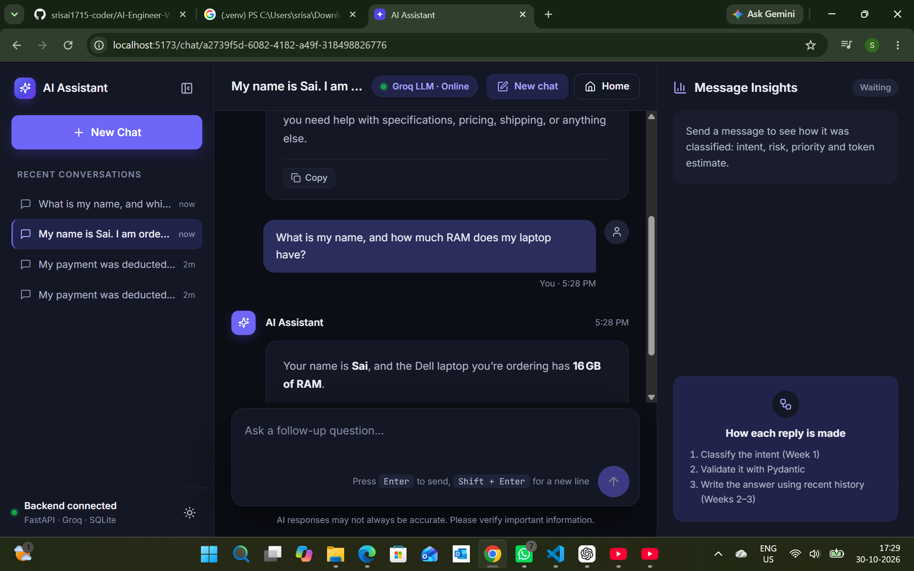
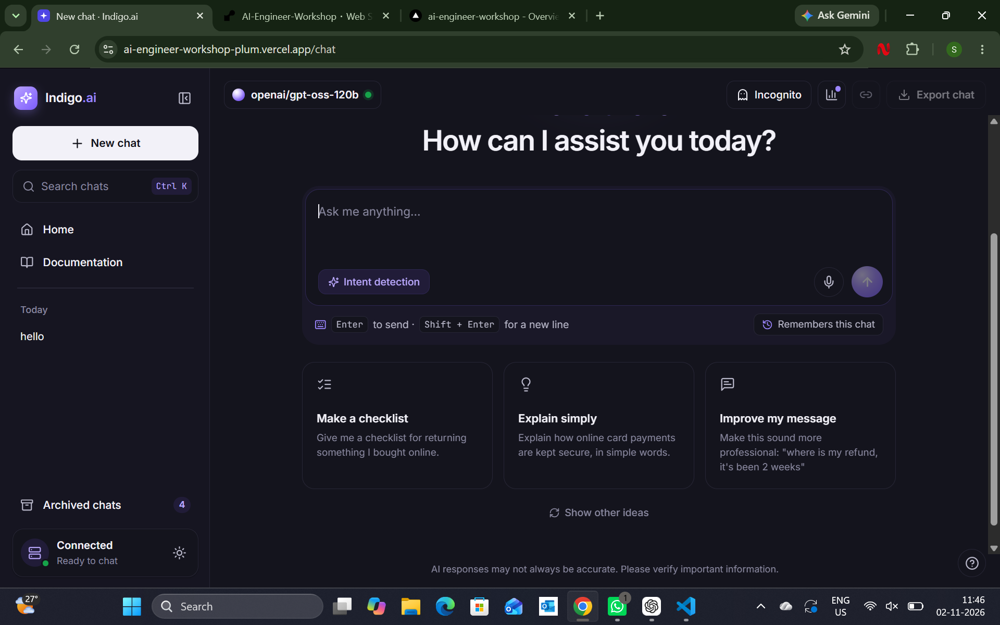
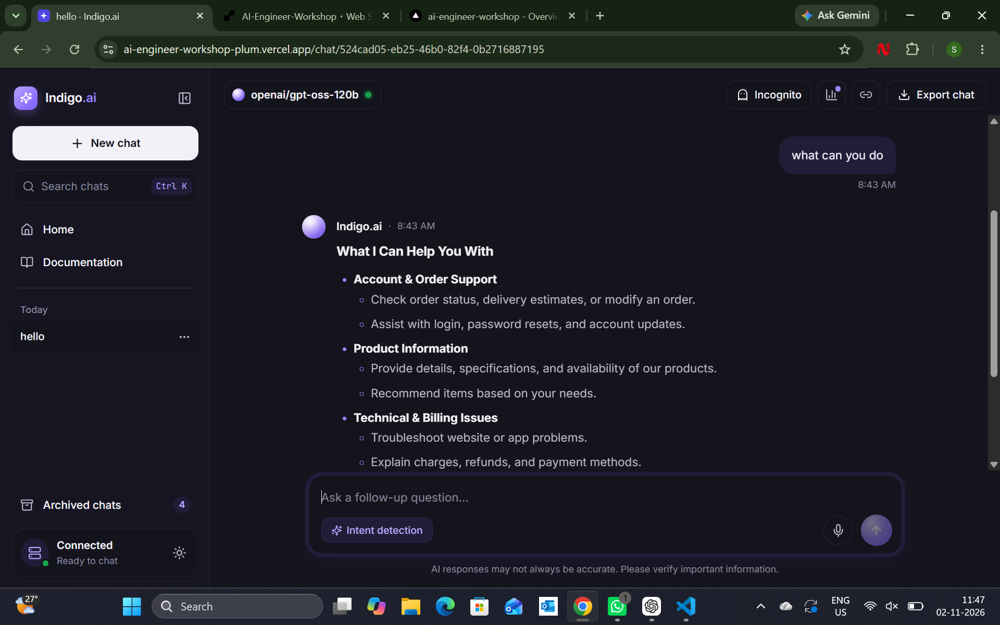

# Indigo.ai – Enterprise Structured Ingestion Firewall

Indigo.ai is an AI-powered customer-support chat application built with a React frontend and a FastAPI backend. It analyzes each user message, validates the structured intent result, generates a contextual Markdown response, and keeps conversation history so follow-up questions can use earlier messages.

## Live application

| Component | URL |
|---|---|
| **Frontend (Vercel)** | https://ai-engineer-workshop-plum.vercel.app |
| **Backend (Render)** | https://ai-engineer-workshop-fxux.onrender.com |
| **Backend health check** | https://ai-engineer-workshop-fxux.onrender.com/health |
| **Interactive API documentation** | https://ai-engineer-workshop-fxux.onrender.com/docs |

Open the frontend URL to use Indigo.ai. The health-check URL verifies that the backend is responding. The `/` route is not the API's home page, so use `/health` or `/docs` to check the backend.

## Project overview

The backend processes a message in stages:

1. **Week 1 – Understands it:** An LLM classifies the message into a supported intent and returns structured data. Pydantic validates the result before the application uses it.
2. **Week 2 – Answers it:** A second LLM call uses the validated intent and context to generate a helpful Markdown response.
3. **Week 3 – Remembers it:** Conversation messages are stored with a session ID, allowing the assistant to answer follow-up questions using previous messages and allowing users to revisit conversations.
4. **Week 4 – Deployment and live application testing:** The React frontend is deployed on Vercel and the FastAPI backend is deployed on Render. The screenshots show the deployed application, its connected status, and a generated chat response.

## Features

- Intent detection and structured message analysis
- Risk profile and priority classification
- Pydantic schema validation
- Context-aware AI responses in Markdown
- Conversation sessions and follow-up memory
- Conversation history, search, archive, restore, and rename features
- React chat interface with responsive layout
- API documentation through Swagger UI
- Separate frontend and backend deployments

## Technology stack

- **Frontend:** React, Vite, JavaScript
- **Backend:** Python, FastAPI
- **LLM provider:** Groq
- **Structured output and validation:** Instructor, Pydantic
- **Database:** SQLite locally; deployed database configuration is provided through environment variables
- **Deployment:** Vercel (frontend), Render (backend)

## Workshop screenshots

The screenshots below document the project outputs and deployment tests. Image paths are relative to the repository root.

### Week 1 – Enterprise Structured Ingestion Firewall

The application classifies a payment-related message and displays its intent, risk profile, priority, action requirement, and estimated token information.



### Week 2 – Intent-Based AI Response Generator

The application generates a context-aware Markdown response and displays it in the React chat interface.



### Week 3 – Conversation Memory and Chat History

The first screenshot shows the start of a conversation. The second shows a follow-up question where the assistant recalls information from the same session.





### Week 4 – Deployment and Live Application

The first screenshot shows the deployed Indigo.ai chat home page with the backend connection status showing **Connected**.



The second screenshot shows a conversation and an AI-generated response in the deployed application.



## Run locally

### Requirements

- Python 3.10 or newer
- Node.js 18 or newer
- A Groq API key
- Git

### 1. Set up the backend

Open a terminal in the repository root:

```powershell
cd backend
python -m venv .venv
.\.venv\Scripts\Activate.ps1
pip install -r requirements.txt
```

### 2. Configure backend environment variables

Create your local environment file:

```powershell
copy .env.example .env
notepad .env
```

Add your own Groq API key and model configuration. Do not commit `.env` or share your API key.

```env
GROQ_API_KEY=your_groq_api_key
GROQ_MODEL=openai/gpt-oss-120b
```

Add any database configuration required by your local setup. The application creates/initializes its configured database during startup.

### 3. Start the backend

From the `backend` directory, with the virtual environment activated:

```powershell
python -m uvicorn app.main:app --reload --port 8000
```

Check the backend at:

- Health: http://127.0.0.1:8000/health
- API documentation: http://127.0.0.1:8000/docs

### 4. Configure and start the frontend

Open a second terminal in the repository root:

```powershell
cd frontend-react
npm install
```

Create `frontend-react/.env` and set the backend URL:

```env
VITE_API_URL=http://127.0.0.1:8000
```

Then start the frontend:

```powershell
npm run dev
```

Open http://localhost:5173.

To stop the local servers, press `Ctrl + C` in their respective terminals.

## Deployment configuration

### Render – backend

The backend is deployed from the `backend/` directory.

- **Root directory:** `backend`
- **Build command:** `pip install -r requirements.txt`
- **Start command:** `uvicorn app.main:app --host 0.0.0.0 --port $PORT`

Configure the required backend environment variables in Render. For example:

- `GROQ_API_KEY`
- `GROQ_MODEL`
- `DATABASE_URL` (if using the hosted PostgreSQL database)
- `ALLOWED_ORIGINS`

The `ALLOWED_ORIGINS` value must include the deployed frontend origin:

```env
ALLOWED_ORIGINS=https://ai-engineer-workshop-plum.vercel.app
```

Use the exact frontend origin configured in Vercel. Do not add a trailing slash unless your backend's CORS configuration specifically expects one.

### Vercel – frontend

The frontend is deployed from the `frontend-react/` directory.

Set this project environment variable in Vercel for the Production environment:

```env
VITE_API_URL=https://ai-engineer-workshop-fxux.onrender.com
```

After changing environment variables, create a new deployment so the frontend build uses the updated value.

## API endpoints

The backend exposes endpoints including:

- `GET /health` – backend health check
- `GET /api/conversations` – list conversations
- `GET /api/conversations/archived` – list archived conversations
- `GET /api/conversations/{session_id}/messages` – retrieve messages for a session
- `POST /api/analyze` – analyze a message and generate a response
- `POST /api/analyze/stream` – stream a generated response

See the complete, current request and response schemas in the [Swagger API documentation](https://ai-engineer-workshop-fxux.onrender.com/docs).

## Repository structure

```text
AI-Engineer-Workshop/
├── backend/
│   ├── app/
│   ├── data/
│   ├── sql/
│   ├── tests/
│   ├── .env.example
│   └── requirements.txt
├── frontend-react/
│   ├── src/
│   ├── public/
│   ├── .env.example
│   └── package.json
├── submission-screenshots/
│   ├── Week-1/
│   ├── week-2/
│   ├── week-3/
│   └── week-4/
├── render.yaml
└── README.md
```

## Important notes

- The assistant provides AI-generated guidance. It does not independently access a retailer's order system, process refunds, or change account details.
- Token counts are estimates and may differ from provider-reported usage.
- Keep `.env`, API keys, database credentials, and local virtual environments out of GitHub.
- The backend may take a short time to respond when a free hosting service wakes from inactivity.
